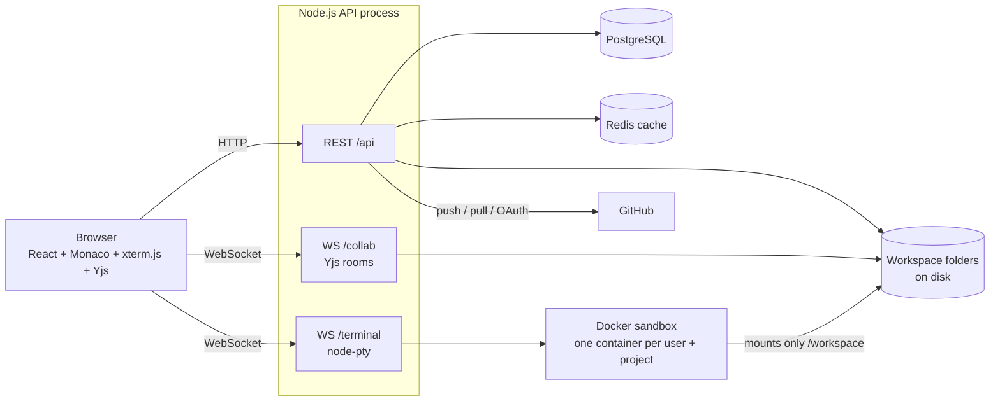

<div align="center">


# CodeSpace

**A free, browser-based code editor with a sandboxed terminal, Git and GitHub built in, and live collaboration.**

[](https://nodejs.org)
[](https://react.dev)
[](https://www.postgresql.org)
[](https://redis.io)
[](https://www.docker.com)
[](#license)

[Live demo](https://your-app.vercel.app) · [Report a bug](https://github.com/your-username/codespace/issues) · [Request a feature](https://github.com/your-username/codespace/issues)

</div>

---

## Table of contents

- [About](#about)
- [Screenshots](#screenshots)
- [Features](#features)
- [Tech stack](#tech-stack)
- [Architecture](#architecture)
- [Project structure](#project-structure)
- [Getting started](#getting-started)
- [Environment variables](#environment-variables)
- [API overview](#api-overview)
- [Roles and permissions](#roles-and-permissions)
- [Security model](#security-model)
- [Performance baseline](#performance-baseline)
- [Deployment](#deployment)
- [Known limitations](#known-limitations)
- [Roadmap](#roadmap)
- [Contributing](#contributing)
- [License](#license)

## About

CodeSpace is a VS Code style editor that runs in the browser. Each project is a real folder on the server, so the editor, the terminal, search and Git all see the same files. Teammates can be invited by username and edit the same file at the same time, with live cursors.

## Screenshots

| Editor | Terminal |
|---|---|
|  |  |

| Live collaboration | Source control |
|---|---|
|  |  |

| Project search | Landing page |
|---|---|
|  |  |

## Features

**Editor**
- Monaco editor (the engine behind VS Code) with syntax highlighting, bracket matching, minimap and autocomplete
- Custom dark theme, tabs, file icons and language detection by extension
- Files are written to disk automatically while you work
- Read-only mode for viewers

**File explorer**
- Nested folders and files, stored as real files on disk
- Right-click menu: open, new file, new folder, rename, delete, copy path, copy name, refresh
- Keyboard shortcuts: `F2` to rename, `Delete` to delete
- Open tabs follow renames and close on deletes

**Search and replace**
- Project-wide search with case, whole-word and regular-expression options
- Click a result to open the file at the match
- Replace in one file or across the whole project, with regex capture groups

**Integrated terminal**
- Real shell (xterm.js in the browser, node-pty on the server)
- Every user gets a separate Docker container per project that sees only that project's folder
- Resizable panel, toggled with `Ctrl + \``
- Container limits on CPU, memory and process count

**Git and GitHub**
- Source Control panel: init, stage, unstage, commit, push and pull
- Live status banner while a Git action runs
- "Connect GitHub" OAuth flow, with tokens stored encrypted and used per command without being written to disk

**Collaboration and sharing**
- Share a project with other users by username
- Per-user roles: Owner, Editor, Viewer
- Shared projects appear under "Shared with me"
- Real-time editing with [Yjs](https://yjs.dev) (a CRDT): several people can type in the same file and the edits merge without conflicts
- Live cursors and selections with names, plus presence indicators in the status bar
- Changes made from the terminal or by `git pull` appear in open editors
- Removing a member or changing a role disconnects their terminal and editor sessions immediately

**Platform**
- Email and password accounts, JWT in an HTTP-only cookie
- Redis cache for hot lookups (user and permission checks) with explicit invalidation, and a safe fallback when Redis is down
- Animated landing page with scroll-driven sections and auth-aware navigation
- Docker Compose setup for the whole backend stack

## Tech stack

| Layer | Technology |
|---|---|
| Frontend | React, Vite, Tailwind CSS, Zustand, Axios, Monaco Editor, xterm.js, Yjs, y-monaco, Lenis, lucide-react |
| Backend | Node.js, Express, ws, node-pty, Prisma, Yjs |
| Database | PostgreSQL (users, projects, members, GitHub connections) |
| Cache | Redis (via ioredis) |
| Sandbox | Docker |
| Auth | JWT in an HTTP-only cookie, GitHub OAuth for repository access |
| Hosting (planned) | Vercel (frontend), Render (API, Postgres, Key Value) |

## Architecture



An editable diagram is in [`docs/codebuild-architecture.drawio`](docs/codebuild-architecture.drawio) (open it at [app.diagrams.net](https://app.diagrams.net)).

**How a few things work**

- **Files:** PostgreSQL stores only users, projects and roles. File contents live on disk at `WORKSPACES_DIR/<projectId>/`, so the editor, terminal and Git always agree.
- **Terminal isolation:** the server starts a Docker container per user and project, mounts only that project's folder as `/workspace`, runs it as a non-root user with dropped capabilities, a read-only root filesystem, and CPU, memory and process limits. `cd ..` lands in the container's own filesystem, not in other users' projects.
- **Collaboration:** each open file has a Yjs document on the server. Edits and cursor positions travel over a WebSocket, and the server saves the text to disk shortly after the last change.
- **Caching:** permission and user lookups use a cache-aside pattern in Redis with short TTLs, and the cache entry is deleted whenever membership changes.

## Project structure

```
.
├── backend/
│   ├── Dockerfile
│   ├── prisma/                 # schema and migrations
│   ├── sandbox/Dockerfile      # image used for terminal containers
│   └── src/
│       ├── controllers/        # auth, project, member, git, github
│       ├── routes/
│       ├── middlewares/        # JWT cookie auth
│       └── lib/                # access, auth, cache, redis, workspace, search, git,
│                               # crypto, github, terminal (WS), collab (WS)
├── frontend/
│   ├── vercel.json
│   └── src/
│       ├── components/         # Explorer, EditorPane, SearchPanel, SourceControl,
│       │                       # TerminalPanel, ShareDialog, GithubConnect
│       ├── hooks/              # useWorkspace
│       ├── store/              # Zustand stores
│       ├── lib/                # axios, file types, Monaco setup
│       └── pages/              # Landing, Login, Register, Dashboard
├── docs/                       # architecture diagram
└── docker-compose.yml
```

## Getting started

### Prerequisites

- Node.js 22 or newer
- Docker and Docker Compose (needed for the terminal, and for the compose setup)
- Git
- A Linux or macOS machine for the terminal feature (Windows works through WSL)
- A GitHub OAuth app (optional, only for push and pull)

<!-- ### Option A: Docker Compose (backend stack) -->

<!-- ```bash
git clone https://github.com/your-username/codespace.git
cd codespace

# 1. Build the sandbox image used for terminals
docker build -t codespace-sandbox backend/sandbox

# 2. Compose settings (root .env)
cat > .env <<EOF
APP_UID=$(id -u)
APP_GID=$(id -g)
DOCKER_GID=$(getent group docker | cut -d: -f3)
WORKSPACES_DIR=$HOME/codespace-workspaces
EOF
mkdir -p "$HOME/codespace-workspaces"

# 3. App settings
cp backend/.env.example backend/.env   # then edit the secrets

# 4. Start Postgres, Redis and the API, then create the tables
docker compose up -d --build
docker compose run --rm api npx prisma migrate deploy
```

Your user must be allowed to run Docker without `sudo` (`docker ps` should work). -->

### Option A: run everything locally

```bash
# Redis and Postgres (or use your own)
docker run -d --name redis -p 6379:6379 redis:7-alpine
docker run -d --name pg -e POSTGRES_PASSWORD=postgres -p 5432:5432 postgres:16-alpine

# Backend
cd backend
cp .env.example .env            # fill in the values
npm install
npx prisma migrate dev
npm run dev
```

### Frontend

```bash
cd frontend
cp .env.example .env
npm install
npm run dev                     # http://localhost:5173
```

Register an account, create a project, and open the terminal with `Ctrl + \``.

## Environment variables

### Backend (`backend/.env`)

| Variable | Description |
|---|---|
| `PORT` | API port (default `5000`) |
| `NODE_ENV` | `development` or `production`. Production enables secure cross-site cookies. |
| `DATABASE_URL` | PostgreSQL connection string |
| `REDIS_URL` | Redis connection string. If unset, the app runs without caching. |
| `JWT_SECRET` | Secret used to sign login tokens |
| `TOKEN_ENC_KEY` | 64 hex characters, used to encrypt GitHub tokens (AES-256-GCM) |
| `CLIENT_URL` | Exact frontend origin, for example `http://localhost:5173`. Used for CORS and the WebSocket origin check. |
| `GITHUB_CLIENT_ID` / `GITHUB_CLIENT_SECRET` | GitHub OAuth app credentials |
| `GITHUB_REDIRECT_URI` | For example `http://localhost:5000/api/github/callback` |
| `WORKSPACES_DIR` | Absolute path where project folders are stored. Keep it outside the repository. |
| `SANDBOX_IMAGE` | Docker image for terminals (default `codespace-sandbox`) |
| `SANDBOX` | Set to `off` to run a plain shell on the host. **Debugging only, no isolation.** |
| `TERMINAL_ENABLED` | `true` to enable the terminal WebSocket. Keep `false` where Docker isn't available. |

Generate secrets with:

```bash
node -e "console.log(require('crypto').randomBytes(32).toString('hex'))"
```

### Frontend (`frontend/.env`)

| Variable | Description |
|---|---|
| `VITE_API_URL` | For example `http://localhost:5000/api` |
| `VITE_WS_URL` | For example `ws://localhost:5000` (`wss://` in production) |
| `VITE_TERMINAL_ENABLED` | `true` to show the terminal |

## API overview

All routes are under `/api` and need the login cookie, except register and login.

| Area | Endpoints |
|---|---|
| Auth | `POST /auth/register`, `POST /auth/login`, `POST /auth/logout`, `GET /auth/check` |
| Projects | `GET /projects`, `POST /projects`, `GET\|PATCH\|DELETE /projects/:projectId` |
| Files | `GET /projects/:id/tree`, `POST\|PATCH\|DELETE /projects/:id/nodes`, `GET\|PUT /projects/:id/file` |
| Search | `POST /projects/:id/search`, `POST /projects/:id/replace` |
| Members | `GET\|POST /projects/:id/members`, `PATCH\|DELETE /projects/:id/members/:userId` |
| Git | `GET /projects/:id/git/status`, `POST .../git/init`, `.../stage`, `.../unstage`, `.../commit`, `PUT .../git/remote`, `POST .../git/push`, `.../pull` |
| GitHub | `POST /github/connect`, `GET /github/callback`, `GET /github/status`, `DELETE /github` |
| WebSockets | `/terminal?projectId=` and `/collab?projectId=&path=` |

## Roles and permissions

| Action | Owner | Editor | Viewer |
|---|:---:|:---:|:---:|
| Open project, read files, search | ✅ | ✅ | ✅ |
| Edit, create, rename, delete files | ✅ | ✅ | ❌ |
| Replace across files | ✅ | ✅ | ❌ |
| Use the terminal | ✅ | ✅ | ❌ |
| Git status | ✅ | ✅ | ✅ |
| Stage, commit, push, pull | ✅ | ✅ | ❌ |
| Share, change roles, remove members | ✅ | ❌ | ❌ |
| Delete the project | ✅ | ❌ | ❌ |

Push and pull use the **acting user's own** connected GitHub account.

## Security model

- Login tokens live in an HTTP-only cookie. WebSocket connections check the request origin and the cookie before anything starts, because WebSockets are not covered by CORS.
- File paths are resolved against the project folder and rejected if they leave it, including through symlinks.
- Every route checks the caller's role in one place (`getAccess`).
- GitHub tokens are encrypted at rest and passed to Git only for the single command, never written to `.git/config`.
- Terminals run in containers with a non-root user, dropped capabilities, a read-only root filesystem and resource limits, and receive none of the server's secrets.
- Revoking access closes open sockets and removes the user's container.

This is **not** a hardened multi-tenant platform. See [Known limitations](#known-limitations) before exposing it to untrusted users.

## Performance baseline

Measured with [autocannon](https://github.com/mcollina/autocannon) against one Node process on a laptop (i5-13420H, 12 threads, 15 GB RAM), PostgreSQL and Docker on the same machine, before the Redis cache was added. Treat these as reference points, not guarantees.

| Endpoint | 1 connection | 10 connections | p99 at 10 connections |
|---|---|---|---|
| List projects | 324 req/s | 1,522 req/s | 10 ms |
| Read file | 250 req/s | 1,504 req/s | 11 ms |
| File tree | 199 req/s | 941 req/s | 14 ms |
| Search | 175 req/s | 409 req/s | 30 ms |
| Git status | 92 req/s | 282 req/s | 45 ms |

No request errors in any run. Search and Git status are the heaviest endpoints, because they read every file or start a `git` process.

## Deployment

The planned setup is Vercel for the frontend and Render for the API, Postgres and Key Value (Redis).

1. Create Render Postgres and Key Value instances in the same region.
2. Create a Render Web Service from `backend/Dockerfile` with the environment variables above (`NODE_ENV=production`, `TERMINAL_ENABLED=false`, internal database and Redis URLs, a production GitHub OAuth app).
3. Deploy the frontend to Vercel with `VITE_API_URL`, `VITE_WS_URL` and `VITE_TERMINAL_ENABLED=false`, then set `CLIENT_URL` on Render to the Vercel URL.
4. Cookies must be `SameSite=None; Secure` in production. Using subdomains of one domain avoids third-party cookie blocking in some browsers.

**The terminal does not work on Render**, because it has no Docker socket. Deploy the terminal on a machine where you control Docker, or leave it disabled.

## Known limitations

- Single API process: collaboration rooms and sockets live in memory, so running several API instances needs shared state (see the roadmap).
- Docker containers share the host kernel. They are not a strong boundary against hostile code. Use gVisor, microVMs or a managed sandbox for untrusted users.
- The Source Control buttons run `git` on the host, not inside the sandbox.
- Terminal `git push` does not authenticate. Use the Source Control panel for push and pull.
- Collaborators on one project share the same folder, so terminal activity from one is visible to the others.
- On free hosting tiers, project files may be lost on restart because the disk is not persistent.
- Undo behaviour after remote edits has not been fully tested.

## Roadmap

- [ ] Redis pub/sub so several API servers can share kick events and collaboration rooms
- [ ] Load balancer in front of multiple API instances
- [ ] Shared storage for workspaces across servers
- [ ] Separate sandbox service so the API no longer controls Docker directly
- [ ] Per-user undo for collaborative editing
- [ ] Run Git inside the sandbox
- [ ] Load and stress testing with k6

## Contributing

Contributions are welcome.

1. Fork the repository and create a branch: `git checkout -b feature/my-feature`
2. Commit your changes: `git commit -m "Add my feature"`
3. Push the branch and open a pull request

Please open an issue first for large changes.

## License

Distributed under the MIT License. Add a `LICENSE` file to the repository root before publishing.

---

<div align="center">

Built by [your-name](https://github.com/your-username)

</div>
